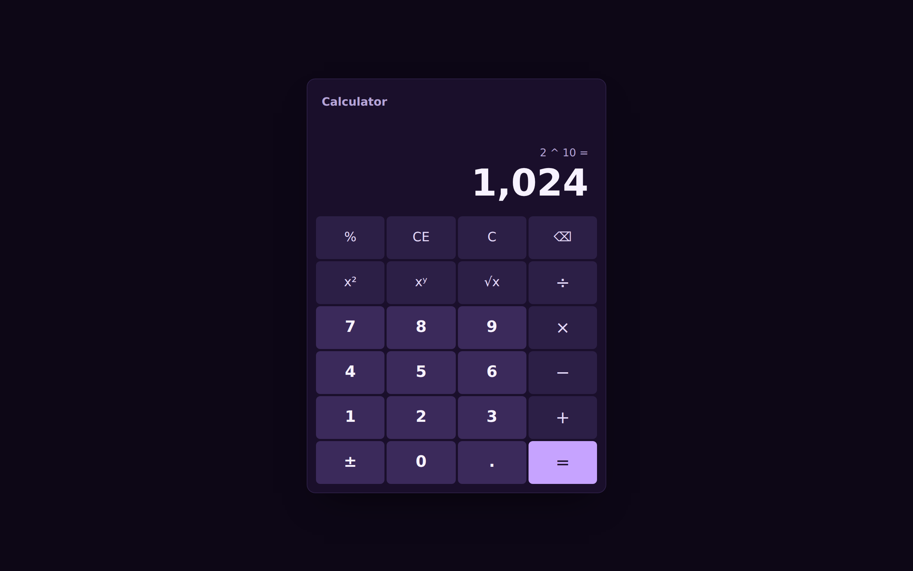
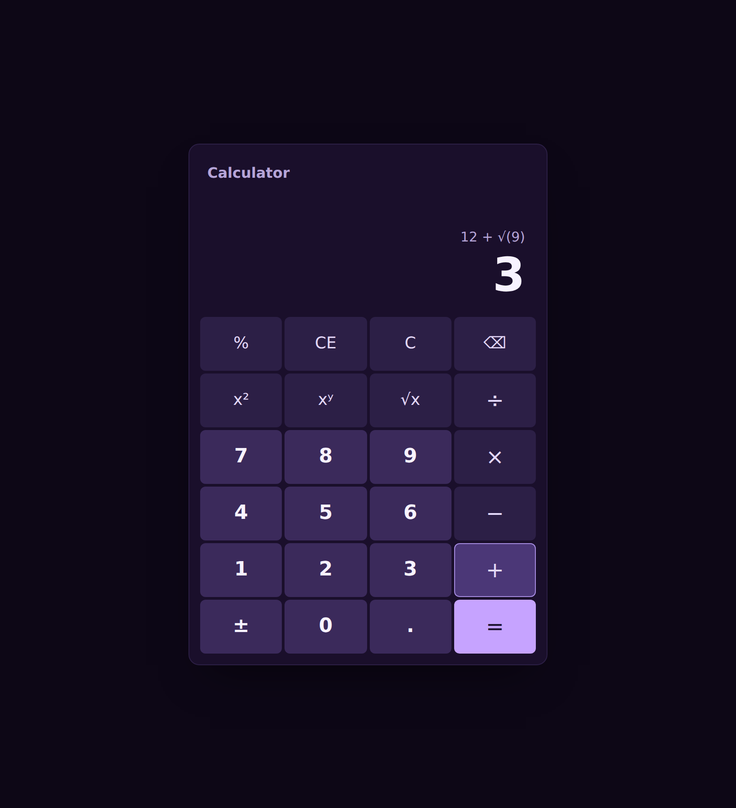
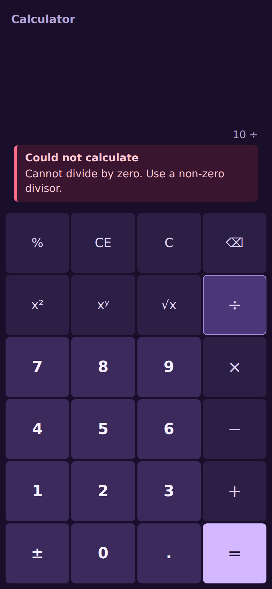

# Calculadora Full-Stack

Calculadora com backend em **Go** (API REST) e frontend em **React + TypeScript**, empacotada com **Docker Compose**.

## 1. Overview

A aplicação faz sete operações: soma, subtração, multiplicação, divisão, potência, raiz quadrada e porcentagem. O frontend valida a entrada (aceita vírgula ou ponto como separador decimal), chama a API e mostra o resultado num display no estilo LCD. Divisão por zero, raiz de número negativo e overflow geram mensagens que explicam o problema e como corrigi-lo.

| Desktop (≥ 1024px) | Tablet (≥ 768px) | Mobile (< 480px) |
|---|---|---|
|  |  |  |

## 2. Architecture

```
┌──────────────────────────── Browser ────────────────────────────┐
│  React 18 + TS (Vite)                                           │
│  components ──► hooks (useCalculator, useOperations) ──► api.ts │
│  (UI apenas)    (estado, validação)        (fetch /api, 10s)    │
└───────────────────────────────┬─────────────────────────────────┘
                                │ HTTPS (TLS 1.2/1.3, HTTP/2) — uma única origem
┌───────────────────────────────▼────────────────── nginx ────────┐
│ :80   /healthz ou 301 → HTTPS                                   │
│ :443  /        → SPA estática (dist/)                           │
│       /api/*   → proxy_pass http://backend:8080 (rede interna)  │
└───────────────────────────────┬─────────────────────────────────┘
                                │ HTTP, rede Docker (porta não publicada)
┌───────────────────────────────▼──────────── Go 1.26 net/http ───┐
│ middleware: Logger → Recover → CORS → [RateLimit → RequireJSON] │
│        │                                                        │
│ handlers   parse JSON, valida (models), chama service, serializa│
│        │                                                        │
│ services   Calculator (interface) → BasicCalculator (lógica pura)│
│        │   sentinel errors: ErrDivisionByZero, ErrOverflow, ... │
│ models     CalculateRequest (tags validate), responses, códigos │
└─────────────────────────────────────────────────────────────────┘
```

**Estrutura** (segue o [golang-standards/project-layout](https://github.com/golang-standards/project-layout/blob/master/README_ptBR.md)):

```
backend/
  cmd/server/main.go        composição: config, logger, sinais, listener
  internal/
    config/                 leitura de variáveis de ambiente
    handlers/               HTTP ⇄ service (sem regra de negócio)
    httpjson/               helpers de resposta JSON
    middleware/             CORS, logger slog, recover, Content-Type
    models/                 request/response, validação via struct tags
    server/                 rotas e graceful shutdown
    services/               regras de cálculo (sem dependência de HTTP)
frontend/
  src/
    components/             Calculator (container), OperationSelector, ResultDisplay, NumberField
    hooks/                  useCalculator, useOperations
    services/api.ts         cliente HTTP tipado (ApiError, timeout)
    types/                  tipos do domínio e discriminated unions
    utils/                  validação, formatação, metadados das operações
```

**Fluxo de uma requisição:** `POST /api/v1/calculate` → `Logger` → `Recover` → `CORS` → `RateLimit` (429 se o IP estourou o limite) → `RequireJSON` (415 se não for JSON) → `handlers.Calculate`, que decodifica, valida com `models.Validate` e chama `services.Calculate`. O resultado passa por verificação de `NaN`/`Inf`. A resposta 200 é serializada; erros sentinela viram 400, cada um com o seu `code`.

## 3. Prerequisites

- [Go 1.22+](https://go.dev/dl/) (o `go.mod` declara 1.26 por causa das dependências atuais)
- [Node.js 20+](https://nodejs.org/) (testado com Node 22)
- [Docker](https://docs.docker.com/engine/install/) com o plugin Compose v2
- Opcional: [golangci-lint v2](https://golangci-lint.run/) e `make`

## 4. Quick start

```bash
docker compose up --build
```

- Aplicação: <https://localhost:3443> (<http://localhost:3000> redireciona para HTTPS)
- API, pelo mesmo endereço: <https://localhost:3443/api/v1/health>

Sem certificado montado, o nginx gera um **certificado autoassinado** na inicialização, e o navegador mostra um aviso na primeira visita. Para continuar, aceite o risco (em "Avançado"). No `curl`, use `-k`. O backend não é publicado no host: ele só é acessível pelo nginx, na rede interna do Docker.

Para mudar portas ou origens de CORS, copie `.env.example` para `.env` e edite os valores.

### HTTPS em produção

Monte o certificado real (por exemplo do Let's Encrypt, via certbot) em `/etc/nginx/certs` com os nomes `fullchain.pem` e `privkey.pem`, descomentando o volume no `docker-compose.yml`:

```yaml
    volumes:
      - ./certs:/etc/nginx/certs:ro
```

Com o certificado presente, o script de inicialização não gera o autoassinado. Em produção, use `HTTP_PORT=80`, `HTTPS_PORT=443` e `HSTS_MAX_AGE=31536000`.

Se quiser HTTPS local sem aviso do navegador, gere o certificado com o [mkcert](https://github.com/FiloSottile/mkcert) (`mkcert -cert-file certs/fullchain.pem -key-file certs/privkey.pem localhost 127.0.0.1`) e monte-o como acima. A CA do mkcert precisa estar confiada no sistema onde o navegador roda.

## 5. Development

**Backend** (porta 8080):

```bash
cd backend
go run ./cmd/server          # ou: make run
```

**Frontend** (porta 5173, com proxy de `/api` para `localhost:8080`):

```bash
cd frontend
npm install
npm run dev
```

Sem `VITE_API_URL` definida, o frontend faz requisições relativas (`/api/...`) e o Vite as repassa ao backend. Assim o CORS não entra em jogo no desenvolvimento.

| Comando | Descrição |
|---|---|
| `make lint` / `npm run lint` | golangci-lint / ESLint |
| `make fmt` / `npm run format` | gofumpt + goimports / Prettier |
| `npm run typecheck` | `tsc --noEmit` (strict) |
| `make build` / `npm run build` | binário em `bin/` / bundle em `dist/` |

**Variáveis de ambiente do backend**

| Variável | Padrão | Descrição |
|---|---|---|
| `PORT` | `8080` | Porta HTTP |
| `CORS_ORIGINS` | `http://localhost:3000,http://localhost:5173` | Origens permitidas, separadas por vírgula (`*` libera todas) |
| `LOG_LEVEL` | `info` | `debug`, `info`, `warn`, `error` |
| `RATE_LIMIT_RPS` | `10` | Requisições por segundo por IP de cliente (`0` desliga) |
| `RATE_LIMIT_BURST` | `20` | Rajada máxima permitida por IP |
| `TRUSTED_PROXIES` | vazio | IPs/CIDRs autorizados a informar o IP real via `X-Real-IP` |

**Variáveis do nginx** (container `frontend`)

| Variável | Padrão | Descrição |
|---|---|---|
| `PUBLIC_HTTPS_PORT` | `443` (`3443` no compose) | Porta usada no redirecionamento HTTP → HTTPS |
| `HSTS_MAX_AGE` | `0` | `max-age` do HSTS. Mantenha `0` com o certificado autoassinado e use `31536000` com um certificado real |
| `CSP_CONNECT_SRC` | `'self'` | Origens que a página pode chamar. Adicione a origem da API se `VITE_API_URL` apontar para fora |

Os timeouts de leitura e escrita são de 10s. O servidor encerra de forma graciosa ao receber `SIGINT` ou `SIGTERM`: espera até 10s pelas requisições em andamento.

## 6. API examples

Os exemplos usam o backend de desenvolvimento (`go run`, em `http://localhost:8080`). Com Docker Compose, use `https://localhost:3443` e o parâmetro `-k` do curl, por exemplo `curl -sk https://localhost:3443/api/v1/health`.

### `POST /api/v1/calculate`

```bash
curl -s -X POST http://localhost:8080/api/v1/calculate \
  -H 'Content-Type: application/json' \
  -d '{"operation":"add","a":10,"b":5}'
```
```json
{"result":15,"operation":"add","operands":{"a":10,"b":5}}
```

Raiz quadrada (`b` é opcional e ignorado):

```bash
curl -s -X POST http://localhost:8080/api/v1/calculate \
  -H 'Content-Type: application/json' -d '{"operation":"sqrt","a":16}'
```
```json
{"result":4,"operation":"sqrt","operands":{"a":16}}
```

Porcentagem, `(a × b) / 100`:

```bash
curl -s -X POST http://localhost:8080/api/v1/calculate \
  -H 'Content-Type: application/json' -d '{"operation":"percentage","a":200,"b":15}'
```
```json
{"result":30,"operation":"percentage","operands":{"a":200,"b":15}}
```

Divisão por zero (400):

```bash
curl -s -X POST http://localhost:8080/api/v1/calculate \
  -H 'Content-Type: application/json' -d '{"operation":"divide","a":10,"b":0}'
```
```json
{"error":"division by zero","code":"DIVISION_BY_ZERO"}
```

Content-Type errado (415):

```bash
curl -s -X POST http://localhost:8080/api/v1/calculate -d '{}'
```
```json
{"error":"Content-Type must be application/json","code":"UNSUPPORTED_MEDIA_TYPE"}
```

**Códigos de erro**

| HTTP | `code` | Quando |
|---|---|---|
| 400 | `INVALID_PAYLOAD` | Corpo não é JSON válido, tem mais de um objeto ou um operando fora do range de float64 |
| 400 | `INVALID_OPERATION` | `operation` ausente ou fora do enum |
| 400 | `MISSING_OPERAND` | `a` ausente, ou `b` ausente em operação binária |
| 400 | `DIVISION_BY_ZERO` | `divide` com `b = 0`, ou `power` com `a = 0` e `b < 0` |
| 400 | `NEGATIVE_SQRT` | `sqrt` com `a < 0` |
| 400 | `OVERFLOW` | Resultado infinito (fora do range de float64) |
| 400 | `UNDEFINED_RESULT` | Resultado `NaN` (ex.: `power` com base negativa e expoente fracionário) |
| 415 | `UNSUPPORTED_MEDIA_TYPE` | `Content-Type` diferente de `application/json` |
| 429 | `RATE_LIMITED` | Limite de requisições por IP excedido. O header `Retry-After` indica em quantos segundos tentar de novo. Não se aplica a `/health` |
| 500 | `INTERNAL_ERROR` | Erro inesperado (o detalhe vai para o log, nunca para o cliente) |

### `GET /api/v1/health`

```bash
curl -s http://localhost:8080/api/v1/health
```
```json
{"status":"ok","version":"1.0.0"}
```

### `GET /api/v1/operations`

```bash
curl -s http://localhost:8080/api/v1/operations
```
```json
{"operations":[
  {"name":"add","symbol":"+","description":"Sum of a and b","operands":2},
  {"name":"subtract","symbol":"−","description":"Difference of a and b","operands":2},
  {"name":"multiply","symbol":"×","description":"Product of a and b","operands":2},
  {"name":"divide","symbol":"÷","description":"Quotient of a divided by b","operands":2},
  {"name":"power","symbol":"^","description":"a raised to the power of b","operands":2},
  {"name":"sqrt","symbol":"√","description":"Square root of a (b is ignored)","operands":1},
  {"name":"percentage","symbol":"%","description":"b percent of a: (a × b) / 100","operands":2}
]}
```

## 7. Testing

**Backend:** testes table-driven com testify, mock do service nos testes de handler e testes de integração do router e do shutdown.

```bash
cd backend
go test -race -cover ./...   # cobertura por pacote
make cover                   # cobertura total (coverage.out)
make cover-html              # gera coverage.html e abre no navegador
```

**Frontend:** Vitest + React Testing Library, com `renderHook` para os hooks e `fetch` mockado com `vi.fn()`.

```bash
cd frontend
npm run test -- --coverage   # relatório de texto + HTML em coverage/index.html
```

| Camada | Meta | Atual |
|---|---|---|
| Backend (`./internal/...`) | ≥ 85% | ~98% |
| Frontend (statements) | ≥ 80% | ~98% |

A configuração do Vitest falha o build se a cobertura do frontend ficar abaixo de 80%. O CI (`.github/workflows/ci.yml`) roda a cada push, a cada PR e uma vez por semana. Ele executa:
- lint, testes e build;
- verificações de segurança: `govulncheck`, `npm audit`, assinaturas npm e Trivy nas imagens (falha com HIGH ou CRITICAL corrigível);
- geração de SBOM (CycloneDX);
- um smoke test com `docker compose`.

O Dependabot mantém atualizadas as dependências Go e npm, as imagens Docker e as Actions. A análise completa de segurança, mapeada para o OWASP Top 10:2025, está em [SECURITY.md](SECURITY.md).

## 8. Design decisions

**Camadas handler/service.** O service não conhece HTTP. Ele recebe `(operation, a, b)` e devolve `(float64, error)`. Por isso as regras de negócio são testadas sem servidor, e o handler é testado com um mock da interface `Calculator`. Trocar o transporte (gRPC, CLI) não exige mudar a lógica. Erros sentinela (`ErrDivisionByZero` etc.) são mapeados para status e `code` numa única tabela no handler.

**Stateless.** Cada requisição carrega tudo o que precisa e não há sessão nem banco. Isso permite escalar horizontalmente sem coordenação, reiniciar sem perder dados e testar de forma determinística.

**float64.** É o tipo nativo do JSON (IEEE-754) e do `Number` do JavaScript, então os dois lados representam o mesmo valor sem conversão. O custo é a imprecisão decimal (`0.1 + 0.2 = 0.30000000000000004`). A API devolve o valor exato do float, e o frontend formata com até 10 casas decimais, exibindo `0,3`.

**Por que não BigDecimal.** Go não tem decimal na stdlib (exigiria `shopspring/decimal` ou `math/big`), e o JSON perderia a precisão de qualquer forma, a menos que os números trafegassem como string. Isso quebraria o contrato pedido (`"a": 10`) e obrigaria o frontend a usar outra biblioteca. Além disso, `sqrt` e `power` com expoente fracionário são irracionais e não têm representação decimal exata. Para uma calculadora de uso geral, float64 com detecção de `Inf`/`NaN` é o equilíbrio certo. Para valores monetários, a escolha seria decimal.

**CSS Modules em vez de Tailwind.** O escopo é pequeno e o visual é específico (teclas com relevo, display LCD). CSS Modules dá escopo local sem runtime nem dependência de build extra, mantém o markup legível e usa design tokens em variáveis CSS (`index.css`). Tailwind compensaria num design system maior ou num time que já o usa.

**Outras decisões:**
- **Validação via struct tags** (`go-playground/validator`) com uma validação customizada `operation`, para que o enum fique num único lugar (`models.Operations()`).
- **Operandos como ponteiros** (`*float64`), para distinguir "ausente" de `0`.
- **`-0` é normalizado para `0`**, e o JSON nunca devolve `-0`.
- **Na porcentagem**, quando `a × b` estoura mas o resultado final cabe, o cálculo usa `a × (b / 100)`.
- **`VITE_API_URL` é build arg**, não variável de runtime, e fica vazia por padrão. O Vite embute o valor no bundle durante o build, e vazio significa requisições relativas (`/api/...`).

**HTTPS e mesma origem.** O nginx termina o TLS (TLS 1.2/1.3 e HTTP/2; no TLS 1.2, só cifras ECDHE + AEAD; no TLS 1.3, troca de chave híbrida pós-quântica X25519MLKEM768), serve a SPA e repassa `/api/*` ao backend pela rede interna. Isso traz quatro vantagens:
- o tráfego entre navegador e servidor é cifrado;
- o backend não fica exposto à internet;
- o navegador fala com uma única origem, então o CORS deixa de ser necessário para o próprio frontend;
- o nginx limita o corpo das requisições em 1 MiB antes de chegar ao Go.

O backend continua falando HTTP puro, mas só dentro da rede do Docker. JWT ou sessão só entram se o projeto passar a ter usuários, porque autenticação não substitui TLS e, numa SPA pública, um token sem login pode ser copiado por qualquer um.

**Headers de segurança.** Ficam num snippet (`frontend/nginx/security-headers.inc.template`) incluído em todo bloco que responde, porque um `add_header` dentro de um `location` anula os herdados do `server`. São estes:
- `Content-Security-Policy`: só scripts da própria origem; estilos e fontes também do Google Fonts; `connect-src 'self'`; `frame-ancestors 'none'`. Limita o estrago de um XSS.
- `Strict-Transport-Security`: configurável e desligado (`max-age=0`) com o certificado autoassinado. Com HSTS ativo, o navegador passaria a exigir um certificado que ele mesmo rejeita, e o site ficaria inacessível.
- `X-Frame-Options: DENY`, contra clickjacking.
- `X-Content-Type-Options: nosniff`.
- `Referrer-Policy: strict-origin-when-cross-origin`.
- `Permissions-Policy`: câmera, microfone, geolocalização, pagamento e USB desligados.
- `Cross-Origin-Opener-Policy: same-origin`.

O nginx também não expõe a versão (`server_tokens off`).

**Rate limiting.** Um token bucket por IP de cliente (`golang.org/x/time/rate`) devolve 429 com `Retry-After`, aplicado a `/calculate` e `/operations`. O `/health` fica de fora para que os health checks nunca recebam 429.
- **Identificação do cliente:** atrás do nginx, todas as conexões vêm do IP do proxy. Por isso o backend usa o header `X-Real-IP`, mas só quando a conexão vem de um IP listado em `TRUSTED_PROXIES`. Um cliente direto não consegue escapar do limite forjando o header.
- **IPv6 agrupado por /64:** um cliente IPv6 controla um /64 inteiro, então limitar por endereço seria fácil de contornar.
- **Memória limitada:** buckets inativos são descartados após 10 minutos, e a tabela guarda no máximo 100 mil clientes (cerca de 16 MiB). Acima disso, clientes novos dividem um bucket de transbordo: um ataque com rotação de IPs é contido como grupo, sem afetar os clientes já conhecidos.
- **Logs:** cada requisição registra `request_id` (gerado pelo nginx e devolvido no header `X-Request-ID`) e `client_ip` (o IP real, pela mesma regra de confiança). Assim dá para correlacionar os logs do nginx e do backend.
- **Limitação:** o estado fica em memória e vale por instância. Com várias réplicas, o limite efetivo se multiplica, e o próximo passo seria um store compartilhado (Redis).
- **`useOperations`** busca as operações na API e cai para a lista local se a API estiver fora do ar, para que a interface continue utilizável.
- **`useCalculator`** descarta respostas de requisições substituídas por outras mais recentes, o que evita race conditions.

## 9. Assumptions

- **Limites numéricos:** operandos e resultados devem caber em float64 (±1,797×10³⁰⁸). Operandos maiores são rejeitados no parsing (`INVALID_PAYLOAD`), e resultados infinitos viram `OVERFLOW`.
- **Precisão:** cerca de 15 a 17 dígitos significativos. O frontend usa notação científica para valores ≥ 10¹⁵ ou < 10⁻⁶.
- **Entrada no frontend:** aceita `12`, `-3,5`, `.5`, `1e6` e vírgula ou ponto como separador decimal. Separadores de milhar não são aceitos (`1.000,5` é ambíguo).
- **Sem persistência:** nenhum cálculo é armazenado, e não há histórico nem autenticação.
- **Nomes de operação** diferenciam maiúsculas e minúsculas (`"ADD"` é inválido).
- **Tamanho do corpo** da requisição limitado a 1 MiB (no nginx e no backend).
- **Rate limit padrão:** 10 req/s por IP, com rajada de 20. Clientes atrás do mesmo NAT compartilham o limite.
- **Certificado autoassinado** por padrão, válido para `localhost` e `127.0.0.1` por 365 dias. Serve só para uso local.

## 10. Future improvements

- **Autenticação:** sessão em cookie `HttpOnly`/`SameSite` ou OIDC, quando houver usuários.
- **Rate limiting distribuído** (Redis) para rodar várias réplicas do backend com um limite único.
- **CSP sem dependências externas:** servir as fontes localmente para remover o Google Fonts da política.
- **Histórico:** persistir cálculos (PostgreSQL) com paginação, e no frontend uma lista dos últimos resultados reutilizáveis.
- **WebSocket:** cálculo em tempo real enquanto o usuário digita e sincronização do histórico entre abas.
- **Expressões:** avaliar expressões completas (`2 * (3 + 4)`) com parser próprio.
- **Precisão arbitrária opcional:** modo decimal com números como string para casos financeiros.
- **Observabilidade:** métricas Prometheus, tracing com OpenTelemetry e request ID nos logs.
- **Documentação OpenAPI** gerada a partir dos models.
- **Testes E2E** com Playwright no CI.
